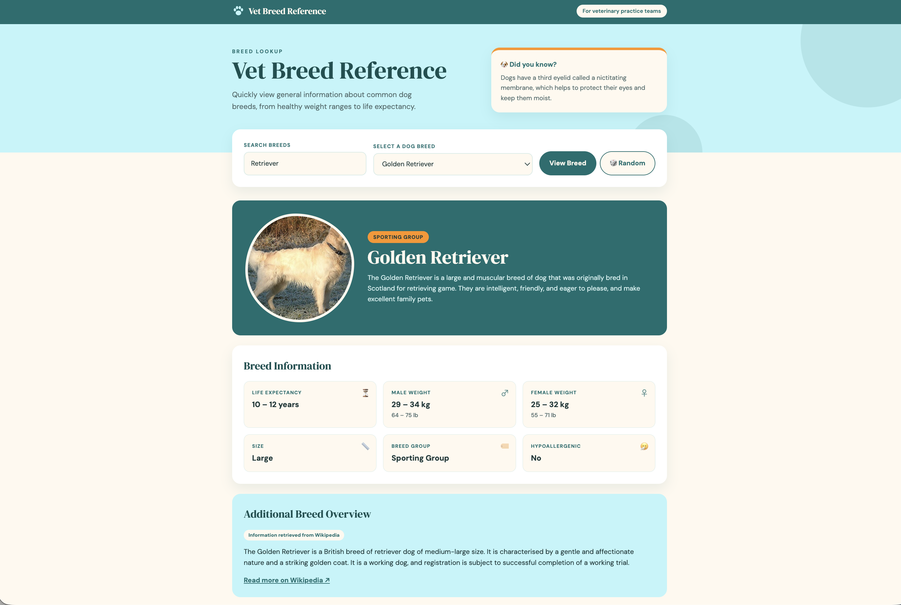

# 🐾 Vet Breed Reference

A quick dog-breed reference for veterinary practice staff. Pick a breed to see its life span, weight ranges in kg and lb, size, breed group, and whether it's hypoallergenic, plus a Wikipedia summary and photo.

🔗 **Live Demo:** [kareemahb.github.io/api-veterinary](https://kareemahb.github.io/api-veterinary/)



## ✨ Features

- **Full breed list**: loads every page of breeds from the Dog API, sorted A to Z
- **Breed search**: type to filter the dropdown. When only one breed matches, it's selected automatically.
- **🎲 Random breed** button
- **Breed details card**:
  - Breed group badge and description
  - Life expectancy
  - Male and female weight ranges in **kg and lb**
  - Size category (Toy, Small, Medium, Large, or Giant), based on the weight range
  - Breed group
  - Whether the breed is hypoallergenic
- **Wikipedia summary and photo** for the selected breed, with a "Read more" link
- **"Did you know?"** dog fact from the Dog API on every visit
- **Fallbacks**: missing fields show "Not available," and a missing photo shows a placeholder
- **Status messages** while loading and clear errors when no breed is selected or the API is down
- **Responsive design** for tablets and phones at the front desk
- **Disclaimer** that the information is general reference only

## 🔍 How It Works

The app chains two free public APIs. Neither one needs an API key.

1. **[Dog API](https://dogapi.dog/)**: on page load, the app gets every page of the breed list (the API sends breeds a page at a time) plus the breed groups, and fills the dropdown. Selecting a breed shows its details from this data.
2. **[Wikipedia API](https://www.mediawiki.org/wiki/API:Main_page)**: the **breed name from the Dog API** is used to search Wikipedia. The app shows the first result's 3-sentence intro and thumbnail image.

```
Dog API ──▶ breed list ──▶ user picks a breed ──▶ breed name ──▶ Wikipedia search ──▶ summary + photo
```

All the logic lives in one `VetBreedApp` class:

| Method                                                   | Job                                                                                                                     |
| -------------------------------------------------------- | ----------------------------------------------------------------------------------------------------------------------- |
| `fetchAllPages()`                                        | Requests page 1, reads how many pages there are, then gets the rest at the same time                                    |
| `loadBreeds()`                                           | Gets all breeds and breed groups from the Dog API                                                                       |
| `loadDogFact()`                                          | Gets a random dog fact for the "Did you know?" card                                                                     |
| `populateBreedSelect()`                                  | Builds the dropdown, filtered by the search box                                                                         |
| `handleSubmit()` / `showRandomBreed()`                   | Find the chosen (or a random) breed and show it                                                                         |
| `displayBreed()`                                         | Fills in the breed details card                                                                                         |
| `formatRange()` / `formatWeight()` / `getSizeCategory()` | Format ranges, convert kg to lb, and work out the size                                                                  |
| `loadWikipediaInfo()`                                    | Searches Wikipedia and shows the summary, photo, and link. It ignores out-of-date answers if you switch breeds quickly. |

## 🎨 Design

| Color  | Hex       |
| ------ | --------- |
| Cream  | `#FFF9F0` |
| Orange | `#FF9606` |
| Aqua   | `#C0F6FA` |
| Teal   | `#006E6F` |

Fonts: [DM Serif Display](https://fonts.google.com/specimen/DM+Serif+Display) for headings and [DM Sans](https://fonts.google.com/specimen/DM+Sans) for body text.

## 🛠️ Tech Stack

- HTML5
- CSS3
- JavaScript (ES6 classes, `async`/`await`, Fetch API, optional chaining `?.`, nullish coalescing `??`)
- [Dog API](https://dogapi.dog/) and the [Wikipedia API](https://www.mediawiki.org/wiki/API:Main_page)
  No frameworks, dependencies, or build tools.

## 📁 Project Structure

```
api-veterinary/
├── index.html   # Breed search, details card, Wikipedia section, disclaimer
├── main.css     # Styling and color palette
├── main.js      # VetBreedApp class
└── image.png    # README screenshot
```

## 🚀 Getting Started

Try it live on **[GitHub Pages](https://kareemahb.github.io/api-veterinary/)**, or run it locally:

```bash
git clone https://github.com/kareemahb/api-veterinary.git
cd api-veterinary
```

Open `index.html` in your browser, or use the **Live Server** extension in VS Code.

## 💡 What I Learned

- Chaining API calls so data from the first API becomes the input for the second
- Building a long query URL for the Wikipedia API with search, extract, and image options
- Handling missing data safely with optional chaining (`?.`) and nullish coalescing (`??`)
- Organizing a front-end app in a class with one method per job
- Showing loading and error states so the user always knows what's happening
- Handling **paginated APIs**: the Dog API only sends part of the list per request, so the app reads `meta.pagination.last` and fetches the rest
- Checking which fields an API actually returns before building the page around them
- Preventing out-of-date responses from overwriting newer ones

## ⚠️ Disclaimer

This app is for general reference only. It is not veterinary advice. Data comes from public sources (Dog API and Wikipedia) and may be incomplete.

## 👩‍💻 Created By

**Kareemah Bahaadur**
[GitHub](https://github.com/kareemahb)
